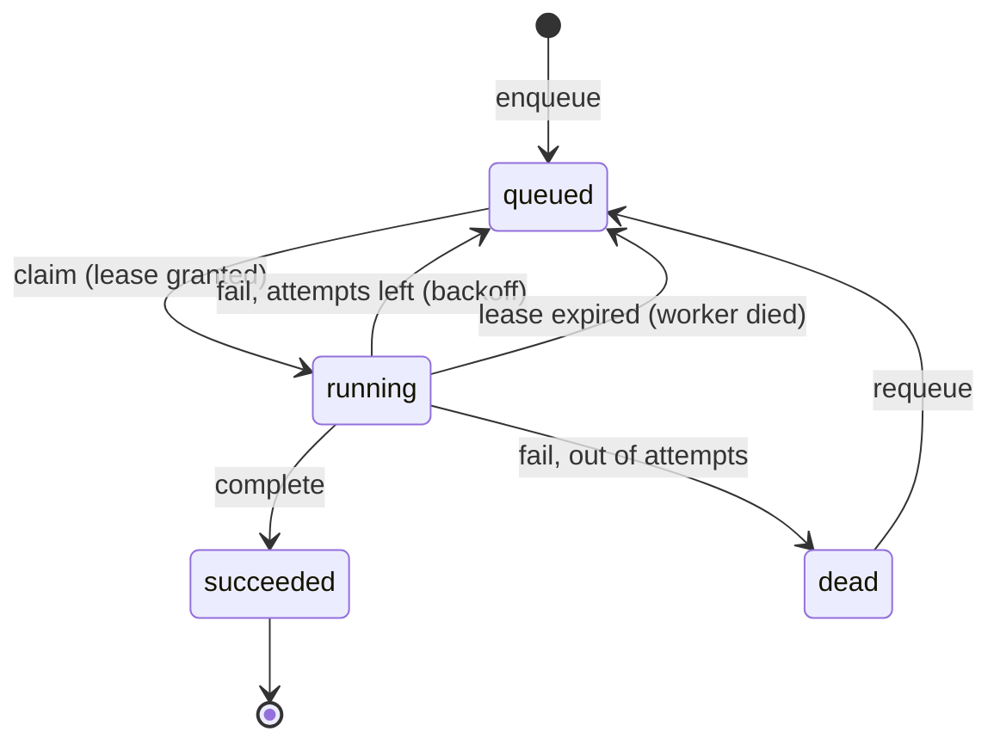

# distributed-job-queue

A durable background-job queue in about 400 lines of Python on SQLite. Several worker processes can share one queue safely. It handles the parts that make job queues hard: crashed workers, retries, poison jobs and duplicate submissions.

No runtime dependencies. Python 3.10+.

## What it guarantees

| Problem | Mechanism | Test |
|---|---|---|
| Two workers grab the same job | `claim` runs in a `BEGIN IMMEDIATE` transaction, so select-and-mark is atomic | 8 threads race for 300 jobs; each is claimed exactly once |
| A worker crashes mid-job | Jobs are leased, not handed over. An expired lease makes the job claimable again | `test_expired_lease_is_reclaimed...` |
| A slow worker finishes after losing its lease | Every write checks the lease owner, so the stale worker's result is rejected | same test: `complete`, `fail` and `heartbeat` all return failure |
| A long job outlives its lease | The worker heartbeats at a third of the lease length | `test_heartbeat_extends_lease` |
| Transient failures | Exponential backoff with full jitter, capped | delays are asserted as 2 s, 4 s, 8 s |
| Poison jobs retry forever | After `max_attempts` the job moves to a dead-letter state with its last error | `test_dead_letter_after_max_attempts_and_requeue` |
| The producer retries a submit | An idempotency key maps a repeat `enqueue` to the original job | `test_idempotency_key_dedupes` |

Delivery is **at-least-once**. A job whose worker died after doing the work but before reporting will run again, so handlers should be idempotent. Exactly-once delivery is not possible here, and this repo does not pretend otherwise.

## Job lifecycle



## Use it

```python
from jobqueue import JobQueue, Worker, task

queue = JobQueue("jobs.db")

@task("send_welcome_email")
def send_welcome_email(payload):
    ...  # raise to trigger a retry

queue.enqueue("send_welcome_email", {"user_id": 42}, idempotency_key="welcome-42")
queue.enqueue("nightly_report", priority=10, delay=3600, max_attempts=3)

Worker(queue).run_forever()   # run as many of these processes as you like
```

Operating it:

```bash
python -m jobqueue stats --db jobs.db
python -m jobqueue dead --db jobs.db
python -m jobqueue requeue <job_id> --db jobs.db
```

## Demo

`python -m jobqueue demo` enqueues 200 jobs and runs 4 workers. One job in five fails twice before succeeding, and one in fifty fails every time. Output from a run on a shared cloud container:

```json
{
  "jobs": 200,
  "workers": 4,
  "seconds": 0.41,
  "handler_runs": 284,
  "queued": 0,
  "running": 0,
  "succeeded": 196,
  "dead": 4
}
```

The numbers add up: 160 jobs run once, 36 run three times, and the 4 permanent failures use all four attempts before being dead-lettered (160 + 108 + 16 = 284). The timing uses shortened backoff and is only there to show the run finishes; it is not a throughput claim.

## Run it

```bash
pip install -e ".[dev]"
pytest -q                     # 12 tests
python -m jobqueue demo

docker build -t jobqueue . && docker run --rm jobqueue
```

## Trade-offs

- **SQLite, one writer at a time.** Claims serialise on the database write lock. That is fine for thousands of jobs per second on one machine, and it means no broker to run. For workers spread across machines, the same design ports to PostgreSQL with `SELECT ... FOR UPDATE SKIP LOCKED`.
- **Polling, not push.** Idle workers poll on an interval. Simple and robust, at the cost of up to one interval of latency.
- **Lease length is a judgement call.** Too short and slow jobs get duplicated; too long and a crash delays recovery. Heartbeats let you keep it short.
